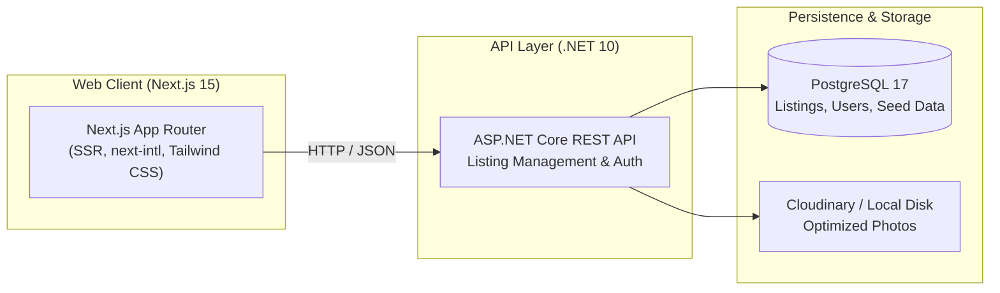

<div align="center">

# 🏡 BasaChai

### Bangla-first rental marketplace MVP built with .NET 10, Next.js 15, PostgreSQL 17, and Playwright

[](https://github.com/akazad13/basachai/actions)
[](https://dotnet.microsoft.com/)
[](https://nextjs.org/)
[](https://react.dev/)
[](https://www.typescriptlang.org/)
[](https://www.postgresql.org/)
[](LICENSE)

[Overview](#-overview) •
[Architecture](#-architecture) •
[Tech Stack](#-tech-stack) •
[Repository Layout](#-repository-layout) •
[Quick Start](#-quick-start) •
[Testing](#-testing) •
[Configuration](#-configuration)

</div>

---

## 📌 Overview

**BasaChai** is a localized, Bangla-first rental marketplace application engineered for the Dhamrai pilot. It connects property owners and tenants through a mobile-first, high-performance interface with multi-lingual support (`next-intl`), robust server-side rendering, and automated end-to-end quality validation.

### Key Highlights
- 🇧🇩 **Bangla-First UX**: Native localization and internationalization (`next-intl`) with desktop and mobile responsive design.
- ⚡ **Next.js 15 App Router & SSR**: Edge-ready server-side rendering with optimized revalidation hooks for instant listing updates.
- 🔒 **Privacy & Data Protection**: Server-side salted IP/device hashing, protected tenant addresses with ASP.NET Core Data Protection, and secure cookie sessions.
- 🧪 **Comprehensive Test Coverage**: 100+ domain tests, 110+ API integration tests with Testcontainers, and 190+ Playwright E2E browser scenarios.

---

## 🏛 Architecture



> [!NOTE]
> The specifications in [`docs/specs`](docs/specs/README.md) serve as the single source of truth for all business rules, UX states, and API contracts.

---

## 🛠 Tech Stack

| Domain | Technologies |
| :--- | :--- |
| **API & Business Logic** | .NET 10, ASP.NET Core, EF Core 10 |
| **Web Frontend** | Next.js 15 (App Router, Server Components), React 19, `next-intl`, Tailwind CSS |
| **Database** | PostgreSQL 17 |
| **Media & Storage** | Cloudinary (Production/Staging) or local disk dev endpoint (`/v1/dev-photos`) |
| **Testing** | xUnit, Testcontainers, Playwright E2E (190+ multi-device runs) |

---

## 📂 Repository Layout

```text
├── src/                  # ASP.NET Core API, domain entities, migrations
├── web/                  # Next.js 15 frontend application (App Router, next-intl)
│   ├── e2e/              # Playwright E2E tests extracted from specs
│   └── scripts/          # Extraction scripts for E2E specs
├── tests/                # Domain and API integration test suites (xUnit + Testcontainers)
├── deploy/               # Seed data (deploy/seed/pilot.json) and deployment assets
├── docs/                 # Specs, master spec, PRD, and technical designs
└── scripts/              # Local development and API startup scripts
```

---

## 🚀 Quick Start

### Prerequisites
- [.NET 10 SDK](https://dotnet.microsoft.com/)
- [Node.js 22+](https://nodejs.org/)
- [Docker Desktop](https://www.docker.com/)

### 1. Configure Environment
```bash
cp .dev.env.example .dev.env
# Set database and test passwords (E2E_PASSWORD and Seed__Password)
```

### 2. Start PostgreSQL and API
```powershell
./scripts/dev-api.ps1
```
The API starts at `http://localhost:5080`.

### 3. Load Seed Dataset
```bash
curl -X POST http://localhost:5080/v1/test/seed -H "Content-Type: application/json" -d '{"dataset":"pilot"}'
```

### 4. Start Web Application
```powershell
cd web
npm install
npm run dev
```
Visit `http://localhost:3000` to browse the rental portal.

---

## 🧪 Testing

| Test Suite | Purpose | Command |
| :--- | :--- | :--- |
| **Domain & API Tests** | Domain validation & API integration tests with Testcontainers | `dotnet test` |
| **Playwright E2E** | Multi-device browser tests across bn-mobile, bn-desktop, en-desktop | `cd web && npx playwright test` |

---

## ⚙️ Configuration

| Key | Layer | Purpose |
| :--- | :--- | :--- |
| `ConnectionStrings:Main` | API | PostgreSQL connection string |
| `Hashing:Salt` | API | Salt for IP and device identifier hashing |
| `Auth:CookieDomain` | API | Domain for shared session cookies |
| `Web:RevalidateUrl` | API | Frontend cache purge endpoint (`/api/revalidate`) |
| `Cloudinary:*` | API | Photo management credentials (CloudName, ApiKey, ApiSecret) |
| `NEXT_PUBLIC_API_URL` | Web | Public API endpoint for browser calls |
| `API_URL` | Web | Server-to-server internal API base URL |

---

## 👤 Author

**Md. Abul Kalam**
- GitHub: [@akazad13](https://github.com/akazad13)
- LinkedIn: [Md. Abul Kalam](https://linkedin.com/in/akazad13)

---

## 📄 License

This project is licensed under the [MIT License](LICENSE).
