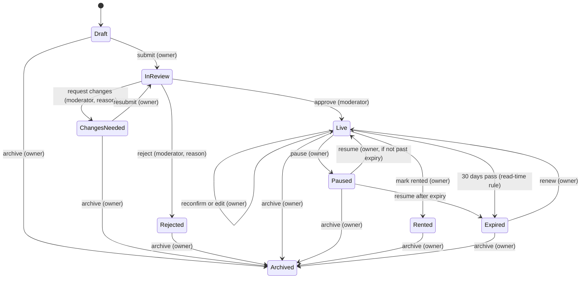

# Listing lifecycle

A listing is visible to tenants only while it is Live, not hidden by a moderator, and within 30 days of its last confirmation. The domain layer allows only the transitions below; anything else returns 409 `invalid_transition`.

Version 1.0 · 13 October 2026 · Source: Master Spec v1.2, section 8 · Covers FR-10, FR-12, FR-16, D7, D12, D23

## Statuses

| Status | Stored value | Bangla | Visible in search |
| --- | --- | --- | --- |
| Draft | `draft` | খসড়া | No |
| In review | `pending` | পর্যালোচনায় | No |
| Changes needed | `changes` | পরিবর্তন দরকার | No |
| Rejected | `rejected` | বাতিল | No |
| Live | `published` | প্রকাশিত | Yes, unless hidden or past expiry |
| Paused | `paused` | বন্ধ | No |
| Rented | `rented` | ভাড়া হয়েছে | No |
| Expired | `expired` | মেয়াদ শেষ | No |
| Archived | `archived` | আর্কাইভ | No |

## Transitions



| From | To | Actor | Guard | Side effects |
| --- | --- | --- | --- | --- |
| Draft | In review | Owner | Required fields set; 3 or more photos stored | `submitted_at` |
| Changes needed | In review | Owner | Same as submit | `submitted_at` |
| In review | Live | Moderator | | `published_at`, `last_confirmed_at = now`, `expires_at = now + 30 days` |
| In review | Changes needed | Moderator | Reason required | Reason stored and shown to owner |
| In review | Rejected | Moderator | Reason required | Reason stored and shown to owner |
| Live | Live (reconfirm) | Owner | | `last_confirmed_at = now`, `expires_at = now + 30 days` |
| Live | Live (edit) | Owner | Same validation as posting | No review (D23); audit log with before and after |
| Live | Paused | Owner | | Leaves search immediately |
| Paused | Live | Owner | `expires_at` in the future | |
| Paused | Expired | Owner (resume) | `expires_at` passed | |
| Live | Rented | Owner | | Leaves search immediately |
| Live | Expired | System (read time) | `expires_at <= now` | See below |
| Expired | Live (renew) | Owner | | Same as reconfirm |
| Any except In review | Archived | Owner | | Hidden from the dashboard; kept for audit |

**Hide** is not a status: a moderator sets `is_hidden` on a Live listing (and can unhide). Hidden listings leave search but keep their status.

## Read-time expiry

There is no scheduler in the MVP (D12).

- `EffectiveStatus(now)` returns Expired when `status = published` and `expires_at <= now`; otherwise the stored status. Every screen and endpoint uses it.
- Public queries also filter `expires_at > now()`, so a listing leaves search the moment its 30 days end.
- The stored status is updated to `expired`, with a history row, on the next write to that listing or when its owner opens the dashboard.

## Edits to Live listings (D23)

- Saving any change keeps the listing Live with no new review.
- The audit log stores the changed fields with before and after values, actor and time.
- The moderation history view shows these edits so reports can be judged against what changed.
- Revisit trigger: moderators find misleading edits, or reports point to bait-and-switch ([roadmap](../roadmap.md)).

## Logging

Every transition writes `listing_availability_history`. Moderator actions also write `moderation_actions` and `audit_log`, in the same transaction.

## Acceptance criteria

- **LIFE-1** Given a Draft with 2 photos, when the owner submits, then 409 is returned with code `photos_required` and the status stays Draft.
- **LIFE-2** Given a listing approved now, then `expires_at` is 30 days later and it is searchable.
- **LIFE-3** Given a Live listing whose `expires_at` passed one minute ago, then it is absent from search and shows Expired on the dashboard before any write happens.
- **LIFE-4** Given a Paused listing past its expiry, when the owner resumes, then it becomes Expired, not Live.
- **LIFE-5** Given an In review listing, when the owner tries to archive it, then 409 `invalid_transition` is returned.
- **LIFE-6** Given a Live listing, when the owner changes the rent, then it stays Live and the audit log holds the old and new rent.
- **LIFE-7** Given a hidden Live listing, then it is absent from search, and unhiding returns it without changing `expires_at`.

## Test cases

State rules are unit-tested with `FakeTimeProvider`; persistence and endpoints are covered by API integration tests. Dashboard behaviour is in DASH-TC01 to TC07.

| ID | Covers | Level | Case | Expected |
| --- | --- | --- | --- | --- |
| LIFE-UT01 | LIFE-3 | Unit | Live listing confirmed at T, read at T + 30 days + 1 minute | `EffectiveStatus` is Expired |
| LIFE-UT02 | LIFE-4 | Unit | Paused listing past expiry, owner resumes | Status becomes Expired |
| LIFE-UT03 | LIFE-5 | Unit | Every action from every status | Allowed exactly as in the transitions table; all others throw `InvalidTransition` |
| LIFE-UT04 | LIFE-2 | Unit | Approve at T; reconfirm at T + 10 days | `ExpiresAt` T + 30 days, then T + 40 days |
| LIFE-API01 | LIFE-1 | API | Submit a draft with 2 photos | 409 `photos_required`; status still Draft |
| LIFE-API02 | LIFE-3 | API | Seed `pilot`; advance clock 3 days; search Dhamrai Bazar | Z1 absent; `GET /owner/listings` shows Z1 Expired; stored status becomes `expired` with a history row |
| LIFE-API03 | LIFE-6 | API | Owner PATCHes Z1 rent to 12,500 | Status stays `published`; audit entry has before 12,000 and after 12,500 |
| LIFE-API04 | LIFE-7 | API | Moderator hides then unhides D3 | Hidden: absent from search, status unchanged. Unhidden: back in search, `ExpiresAt` unchanged |

### Automation (unit)

```csharp
// tests/BasaChai.Domain.Tests/ListingLifecycleTests.cs
public class ListingLifecycleTests
{
    private static readonly DateTimeOffset T0 = DateTimeOffset.Parse("2026-10-13T06:00:00Z");

    [Fact] // LIFE-UT01
    public void Live_listing_past_expiry_reads_as_expired()
    {
        var listing = ListingBuilder.Live(confirmedAt: T0);
        Assert.Equal(ListingStatus.Published, listing.EffectiveStatus(T0.AddDays(30).AddMinutes(-1)));
        Assert.Equal(ListingStatus.Expired, listing.EffectiveStatus(T0.AddDays(30).AddMinutes(1)));
    }

    [Fact] // LIFE-UT02
    public void Resuming_after_expiry_expires_instead()
    {
        var listing = ListingBuilder.Live(confirmedAt: T0);
        listing.Pause(T0.AddDays(5));
        listing.Resume(T0.AddDays(31));
        Assert.Equal(ListingStatus.Expired, listing.Status);
    }

    public static TheoryData<ListingStatus, ListingAction, bool> Matrix => TransitionMatrix.All();   // built from the spec table

    [Theory, MemberData(nameof(Matrix))] // LIFE-UT03
    public void Only_listed_transitions_are_allowed(ListingStatus from, ListingAction action, bool allowed)
    {
        var listing = ListingBuilder.InStatus(from, T0);
        var act = () => listing.Apply(action, ActorFor(action), T0, reason: "Reason");
        if (allowed) act(); else Assert.Throws<InvalidTransitionException>(act);
    }

    [Fact] // LIFE-UT04
    public void Approve_and_reconfirm_set_thirty_days()
    {
        var listing = ListingBuilder.InStatus(ListingStatus.Pending, T0);
        listing.Approve(moderatorId: Guid.NewGuid(), T0);
        Assert.Equal(T0.AddDays(30), listing.ExpiresAt);
        listing.Reconfirm(T0.AddDays(10));
        Assert.Equal(T0.AddDays(40), listing.ExpiresAt);
    }
}
```

### Automation (API)

```csharp
// tests/BasaChai.Api.Tests/LifecycleTests.cs
public class LifecycleTests(ApiFactory f) : IClassFixture<ApiFactory>, IAsyncLifetime
{
    public Task InitializeAsync() => f.ResetAsync();
    public Task DisposeAsync() => Task.CompletedTask;

    [Fact] // LIFE-API01
    public async Task Submit_needs_three_photos()
    {
        var owner = await f.AsAsync("owner");
        var id = await owner.CreateDraftAsync(photos: 2);
        var res = await owner.PostAsync($"/v1/owner/listings/{id}/submit", null);
        Assert.Equal(HttpStatusCode.Conflict, res.StatusCode);
        Assert.Equal("photos_required", (await res.Content.ReadFromJsonAsync<ProblemDto>())!.Code);
    }

    [Fact] // LIFE-API02
    public async Task Expiry_applies_at_read_time_and_persists_on_dashboard_visit()
    {
        f.Clock.Advance(TimeSpan.FromDays(3));
        var anon = await f.AsAsync("anonymous");
        var bazar = await anon.GetFromJsonAsync<SearchPage>("/v1/listings?area=bazar");
        Assert.DoesNotContain(bazar!.Items, c => c.ShortId == "Z1");
        var owner = await f.AsAsync("owner");
        var mine = await owner.GetFromJsonAsync<List<OwnerListingDto>>("/v1/owner/listings");
        Assert.Equal("expired", mine!.Single(l => l.ShortId == "Z1").Status);
        await using var db = f.Db();
        Assert.True(await db.AvailabilityHistory.AnyAsync(h => h.Listing.ShortId == "Z1" && h.ToStatus == "expired" && h.ActorType == "system"));
    }

    [Fact] // LIFE-API03
    public async Task Editing_a_live_listing_keeps_it_live_and_audits_the_change()
    {
        var owner = await f.AsAsync("owner");
        (await owner.PatchAsJsonAsync("/v1/owner/listings/Z1", new { MonthlyRent = 12_500 })).EnsureSuccessStatusCode();
        await using var db = f.Db();
        Assert.Equal(ListingStatus.Published, (await db.Listings.SingleAsync(l => l.ShortId == "Z1")).Status);
        var audit = await db.AuditLog.Where(a => a.Action == "listing.edit").OrderByDescending(a => a.CreatedAt).FirstAsync();
        Assert.Equal(12_000, audit.Before!.RootElement.GetProperty("monthlyRent").GetInt32());
        Assert.Equal(12_500, audit.After!.RootElement.GetProperty("monthlyRent").GetInt32());
    }

    [Fact] // LIFE-API04
    public async Task Hide_and_unhide_keep_status_and_expiry()
    {
        var mod = await f.AsAsync("moderator");
        await using var before = f.Db();
        var expires = (await before.Listings.SingleAsync(l => l.ShortId == "D3")).ExpiresAt;
        (await mod.PostAsync("/v1/admin/listings/D3/hide", null)).EnsureSuccessStatusCode();
        var anon = await f.AsAsync("anonymous");
        Assert.DoesNotContain((await anon.GetFromJsonAsync<SearchPage>("/v1/listings?area=dokkhin"))!.Items, c => c.ShortId == "D3");
        (await mod.PostAsync("/v1/admin/listings/D3/unhide", null)).EnsureSuccessStatusCode();
        await using var after = f.Db();
        var d3 = await after.Listings.SingleAsync(l => l.ShortId == "D3");
        Assert.Equal((ListingStatus.Published, expires), (d3.Status, d3.ExpiresAt));
    }
}
```

## Related

[owner dashboard](../features/owner-dashboard.md) · [moderation and admin](../features/moderation-and-admin.md) · [data model](../tech/data-model.md)
