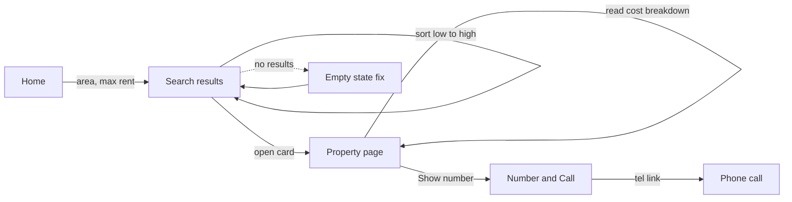
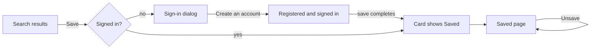
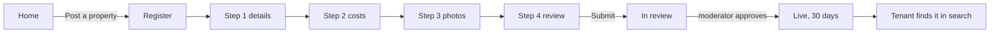
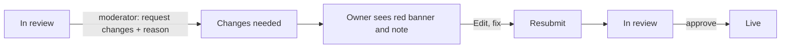
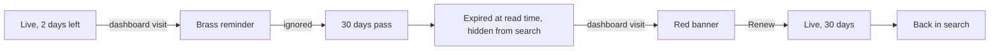
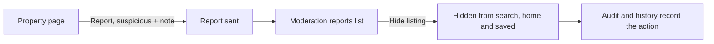
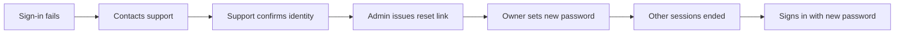

# End-to-end journeys

Seven journeys follow real people across screens and roles, from first visit to outcome. Each has a flow, a step table linked to the acceptance criteria it exercises, and one automated journey test. Together they cover every item on the [launch checklist](requirements.md#launch-checklist).

Version 1.0 · 13 October 2026 · Dataset `pilot` ([test data](tech/quality-and-testing.md#test-data-the-pilot-dataset))

| ID | Journey | Actors | Launch checklist items |
| --- | --- | --- | --- |
| [JRN-01](#jrn-01-a-tenant-finds-a-home-and-calls-the-owner) | A tenant finds a home and calls the owner | Tenant (phone) | 1, 2, 3, 8 |
| [JRN-02](#jrn-02-a-tenant-shortlists-homes-and-signs-up-on-the-way) | A tenant shortlists homes and signs up on the way | Tenant | 1 |
| [JRN-03](#jrn-03-an-owner-posts-a-first-property-and-it-goes-live) | An owner posts a first property and it goes live | Owner, moderator, tenant | 4, 6, 9 |
| [JRN-04](#jrn-04-a-listing-needs-changes-before-approval) | A listing needs changes before approval | Owner, moderator | 5, 6 |
| [JRN-05](#jrn-05-a-listing-is-kept-fresh-expires-and-is-renewed) | A listing is kept fresh, expires and is renewed | Owner, tenant | 5, 7 |
| [JRN-06](#jrn-06-a-tenant-reports-a-scam-and-a-moderator-hides-it) | A tenant reports a scam and a moderator hides it | Tenant, moderator | 6, 7 |
| [JRN-07](#jrn-07-an-owner-forgets-their-password) | An owner forgets their password | Owner, support, admin | (D10) |

## Journey test setup

Journey tests live in `web/e2e/journeys/`, are tagged `@journey`, and run in the `bn-desktop` project (JRN-01 also in `bn-mobile`, and every journey once in `en-desktop` before releases). Each actor gets its own browser context, so sessions never mix.

```ts
// web/e2e/journeys/actors.ts
import { devices, type Browser, type Page } from '@playwright/test';
import { USERS } from '../seed-data';

const API = process.env.E2E_API_URL!;

export async function actor(browser: Browser, opts: { role?: keyof typeof USERS; mobile?: boolean } = {}): Promise<Page> {
  const context = await browser.newContext({
    baseURL: process.env.E2E_WEB_URL,
    ...(opts.mobile ? devices['Pixel 7'] : { viewport: { width: 1280, height: 900 } }),
  });
  const page = await context.newPage();
  if (opts.role) {
    const res = await page.request.post(`${API}/v1/auth/login`, {
      data: { phone: USERS[opts.role].phone, password: process.env.E2E_PASSWORD },
    });
    if (!res.ok()) throw new Error(`Sign-in failed for ${opts.role}`);
  }
  return page;
}
```

---

## JRN-01 A tenant finds a home and calls the owner

**Persona:** Rahim, a bank clerk moving to Dhamrai with his wife and child; budget up to ৳12,000 rent; browsing on a mid-range Android phone in Bangla.
**Goal:** find a 2-bedroom home in Dokkhin Para, understand the full monthly cost, and call the owner.



| Step | Screen | Action | Expected | Criteria |
| --- | --- | --- | --- | --- |
| 1 | Home | Opens `/bn` | 4 recently confirmed homes; search form | HOME-1 |
| 2 | Home | Chooses Dokkhin Para, max rent 12000, presses "বাসা খুঁজুন" | Lands on `/bn/search?area=dokkhin&max=12000`; 2 results (D2, D3) | HOME-3, SRCH-1, SRCH-2 |
| 3 | Results | Sorts "কম ভাড়া আগে" | D2 (৳7,500) above D3 (৳10,500); URL has `sort=rent_asc` | SRCH-4 |
| 4 | Results | Opens D3 | Property page; cost breakdown shows total ৳১২,৭৮০ and advance ৳২১,০০০ in the one-time box | PROP-1 |
| 5 | Property | Sees "নম্বর যাচাই করা হয়নি" and the safety line | Both visible above the facts on a phone | PROP-5, PROP-8 |
| 6 | Property | Presses "নম্বর দেখুন" | Number in Bangla digits and a "কল করুন" link to `tel:+8801900001010`; `contact_revealed` recorded | PROP-2, ANA-2 |

**Alternate path:** at step 2 Rahim picks Barat Nagor with 3 bedrooms, sees the empty state, presses "পুরো ধামরাই দেখুন" and gets 4 results (SRCH-5).

**Success:** Rahim has the owner's number and the true monthly cost, without creating an account.

```ts
// web/e2e/journeys/jrn-01-find-and-call.spec.ts
import { test, expect } from '../fixtures';

test('JRN-01 @journey a tenant finds a home and calls the owner', async ({ page, t, money, num, seed, api }) => {
  await seed('pilot');
  await page.goto('/bn');
  await page.getByLabel(t('f_area')).selectOption('dokkhin');
  await page.getByLabel(t('f_max')).fill('12000');
  await page.getByRole('button', { name: t('search_btn') }).click();
  await expect(page.getByRole('status')).toHaveText(t('results_n', { n: num(2) }));

  await page.getByLabel(t('sort')).selectOption('rent_asc');
  await expect(page).toHaveURL(/sort=rent_asc/);
  const cards = page.getByTestId('results-list').getByRole('article');
  await expect(cards.first()).toContainText(money(7_500 + 500));          // D2 total
  await cards.nth(1).getByRole('link').last().click();

  await expect(page.getByTestId('cost-total')).toHaveText(money(12_780));
  await expect(page.getByText(t('not_verified'))).toBeVisible();
  await page.getByRole('button', { name: t('show_number') }).click();
  await expect(page.getByRole('link', { name: t('call') })).toHaveAttribute('href', 'tel:+8801900001010');

  const events = await (await api.get('/v1/test/events?name=contact_revealed')).json();
  expect(events.at(-1).props.listingId).toBe('D3');
});
```

---

## JRN-02 A tenant shortlists homes and signs up on the way

**Persona:** Shirin, a college student comparing places for herself and a friend.
**Goal:** keep a shortlist across visits.



| Step | Screen | Action | Expected | Criteria |
| --- | --- | --- | --- | --- |
| 1 | Results | Opens `/bn/search?occ=students` and presses Save on A3 | Sign-in dialog: "বাসা সংরক্ষণ করতে সাইন ইন করুন।" | AUTH-3 |
| 2 | Dialog | Chooses "Create an account", enters name, `০১৭১২৩৪৫৬৭৮`, a password | Account created; signed in; A3 now shows "সংরক্ষিত" | AUTH-1, AUTH-3 |
| 3 | Results | Saves D2 | "Saved" message | SAVE-1 |
| 4 | Header | Opens "সংরক্ষিত" | `/bn/saved` with A3 and D2 | SAVE-1 |
| 5 | Saved | Presses "Saved" on A3 to unsave | A3 removed from the page | FR-14 |

**Success:** two homes on the shortlist; no code was sent to her phone (AUTH-6).

```ts
// web/e2e/journeys/jrn-02-shortlist.spec.ts
import { test, expect } from '../fixtures';
import { listing } from '../seed-data';

test('JRN-02 @journey a tenant shortlists homes and signs up on the way', async ({ page, t, seed }) => {
  await seed('pilot');
  await page.goto('/bn/search?occ=students');
  const card = (id: string) => page.getByRole('article').filter({ hasText: listing(id).title.bn });

  await card('A3').getByRole('button', { name: t('save') }).click();
  const dialog = page.getByRole('dialog');
  await expect(dialog).toContainText(t('signin_why_save'));
  await dialog.getByRole('button', { name: t('create_account') }).click();
  await dialog.getByLabel(t('name')).fill('শিরিন');
  await dialog.getByLabel(t('phone')).fill('০১৭১২৩৪৫৬৭৮');
  await dialog.getByLabel(t('password')).fill(process.env.E2E_PASSWORD!);
  await dialog.getByRole('button', { name: t('create_account') }).click();
  await expect(card('A3').getByRole('button', { name: t('saved') })).toHaveAttribute('aria-pressed', 'true');

  await card('D2').getByRole('button', { name: t('save') }).click();
  await page.getByRole('link', { name: t('nav_saved') }).click();
  await expect(page.getByRole('article')).toHaveCount(2);

  await card('A3').getByRole('button', { name: t('saved') }).click();
  await expect(page.getByRole('article')).toHaveCount(1);
});
```

---

## JRN-03 An owner posts a first property and it goes live

**Persona:** Kamal, who owns a 2-bedroom flat in Islampur and has never advertised online.
**Goal:** get the flat in front of tenants for free.



| Step | Actor | Screen | Action | Expected | Criteria |
| --- | --- | --- | --- | --- | --- |
| 1 | Kamal | Home | Presses "বিজ্ঞাপন দিন", registers | Becomes an owner; lands on `/bn/post` | AUTH-1 |
| 2 | Kamal | Step 1 | Title "ইসলামপুরে ২ শোবার ঘরের ফ্ল্যাট", Islampur, 2 beds, 1 bath, Now | Next succeeds | POST-1 |
| 3 | Kamal | Step 2 | Rent 9000, service 500, gas 1080 monthly, advance 18000 | Preview total ৳১০,৫৮০ | POST-2 |
| 4 | Kamal | Step 3 | Uploads 3 photos (one with GPS) | "৩/২০টি ছবি"; Next enabled | POST-4, PHOTO-1 |
| 5 | Kamal | Step 4 | Presses "পর্যালোচনায় জমা দিন" | "পর্যালোচনায় জমা হয়েছে"; dashboard shows In review | POST-7 |
| 6 | Moderator | Moderation | Sees Kamal's listing last in the queue; approves | "Approved" message; queue shrinks | MOD-1, MOD-3 |
| 7 | Kamal | Dashboard | Opens My listings | Listing is Live with 30 days left | DASH |
| 8 | Tenant | Search | Opens `/bn/search?area=islampur` | Kamal's listing appears, confirmed today, total ৳১০,৫৮০ | SRCH-1 |

**Success:** the listing is live within one review; no money, SMS or verification was needed.

```ts
// web/e2e/journeys/jrn-03-post-and-go-live.spec.ts
import { test, expect } from '../fixtures';
import { actor } from './actors';
import { photos } from '../helpers';

test('JRN-03 @journey an owner posts a first property and it goes live', async ({ browser, page, t, num, money, seed }) => {
  await seed('pilot');
  const title = 'ইসলামপুরে ২ শোবার ঘরের ফ্ল্যাট (JRN-03)';

  // Kamal registers from "Post a property"
  await page.goto('/bn');
  await page.getByRole('button', { name: t('nav_post') }).click();
  const dialog = page.getByRole('dialog');
  await dialog.getByRole('button', { name: t('create_account') }).click();
  await dialog.getByLabel(t('name')).fill('কামাল');
  await dialog.getByLabel(t('phone')).fill('01712000003');
  await dialog.getByLabel(t('password')).fill(process.env.E2E_PASSWORD!);
  await dialog.getByRole('button', { name: t('create_account') }).click();
  await expect(page).toHaveURL(/\/bn\/post/);

  // Steps 1 to 4
  await page.getByLabel(t('l_title')).fill(title);
  await page.getByLabel(t('f_area')).selectOption('islampur');
  await page.getByLabel(t('f_beds')).selectOption('2');
  await page.getByRole('button', { name: t('next') }).click();
  await page.getByLabel(t('l_rent')).fill('9000');
  await page.getByLabel(t('l_service')).fill('500');
  await page.getByRole('button', { name: t('add_cost') }).click();
  await page.getByLabel(t('other_label')).fill('গ্যাস বিল');
  await page.getByLabel(t('other_amount')).fill('1080');
  await page.getByLabel(t('l_advance')).fill('18000');
  await expect(page.getByTestId('cost-total')).toHaveText(money(10_580));
  await page.getByRole('button', { name: t('next') }).click();
  await page.locator('input[type="file"]').setInputFiles(photos(['room-gps.jpg', 'room-2.jpg', 'room-3.jpg']));
  await expect(page.getByText(t('photos_n', { n: num(3) }))).toBeVisible();
  await page.getByRole('button', { name: t('next') }).click();
  await page.getByRole('button', { name: t('submit') }).click();
  await expect(page.getByRole('heading', { name: t('submitted_t') })).toBeVisible();

  // Moderator approves
  const mod = await actor(browser, { role: 'moderator' });
  await mod.goto('/bn/admin');
  const item = mod.getByTestId('review-queue').getByRole('article').filter({ hasText: title });
  await item.getByRole('button', { name: t('approve') }).click();
  await expect(mod.getByRole('status')).toHaveText(t('t_approved'));

  // Kamal sees it live; a tenant finds it
  await page.goto('/bn/dashboard');
  await expect(page.getByRole('article').filter({ hasText: title })).toContainText(t('days_left', { n: num(30) }));
  const tenant = await actor(browser, { mobile: true });
  await tenant.goto('/bn/search?area=islampur');
  await expect(tenant.getByRole('article').filter({ hasText: title })).toContainText(money(10_580));
});
```

---

## JRN-04 A listing needs changes before approval

**Persona:** Nasrin (seeded `owner`); her listing M4 is in review.
**Goal:** fix what the moderator asks and get approved.



| Step | Actor | Screen | Action | Expected | Criteria |
| --- | --- | --- | --- | --- | --- |
| 1 | Moderator | Moderation | Opens M4, presses "পরিবর্তন চান", tries to send with no reason | "কারণ লিখতে হবে" | MOD-2 |
| 2 | Moderator | Dialog | Enters "রান্নাঘরের একটি ছবি যোগ করুন।" and sends | M4 leaves the queue | MOD-7 |
| 3 | Nasrin | Dashboard | Opens My listings | Red banner for M4; row shows "পরিবর্তন দরকার" and the note | DASH-3 |
| 4 | Nasrin | Post steps | Edit, adds a fourth photo, resubmits | M4 back to In review | LIFE transitions |
| 5 | Moderator | Moderation | Approves M4 | M4 Live; history shows request, resubmit and approve | MOD-5 |

```ts
// web/e2e/journeys/jrn-04-changes-requested.spec.ts
import { test, expect } from '../fixtures';
import { actor } from './actors';
import { listing } from '../seed-data';
import { photos } from '../helpers';

test('JRN-04 @journey a listing needs changes before approval', async ({ browser, t, seed }) => {
  await seed('pilot');
  const m4 = listing('M4').title.bn;
  const reason = 'রান্নাঘরের একটি ছবি যোগ করুন।';

  const mod = await actor(browser, { role: 'moderator' });
  await mod.goto('/bn/admin');
  const item = () => mod.getByTestId('review-queue').getByRole('article').filter({ hasText: m4 });
  await item().getByRole('button', { name: t('request_changes') }).click();
  await mod.getByRole('dialog').getByRole('button', { name: t('send') }).click();
  await expect(mod.getByText(t('reason_err'))).toBeVisible();
  await mod.getByRole('dialog').getByRole('textbox').fill(reason);
  await mod.getByRole('dialog').getByRole('button', { name: t('send') }).click();
  await expect(item()).toHaveCount(0);

  const owner = await actor(browser, { role: 'owner' });
  await owner.goto('/bn/dashboard');
  const row = owner.getByRole('article').filter({ hasText: m4 });
  await expect(row).toContainText(t('st_changes'));
  await expect(row).toContainText(reason);
  await row.getByRole('button', { name: t('edit') }).click();
  await owner.getByRole('button', { name: t('next') }).click();
  await owner.getByRole('button', { name: t('next') }).click();
  await owner.locator('input[type="file"]').setInputFiles(photos(['room-4.jpg']));
  await owner.getByRole('button', { name: t('next') }).click();
  await owner.getByRole('button', { name: t('submit') }).click();

  await mod.reload();
  await item().getByRole('button', { name: t('approve') }).click();
  await owner.goto('/bn/dashboard');
  await expect(row).toContainText(t('st_published'));
});
```

---

## JRN-05 A listing is kept fresh, expires and is renewed

**Persona:** Nasrin; her flat Z1 was confirmed 28 days ago.
**Goal:** keep only available homes in search, with no SMS or push.



| Step | Actor | Screen | Action | Expected | Criteria |
| --- | --- | --- | --- | --- | --- |
| 1 | Nasrin | Dashboard | Opens My listings | Brass banner: Z1 expires in ২ days; header badge ৩ | DASH-1, DASH-4 |
| 2 | (time) | | 3 days pass with no action | No job runs | D12 |
| 3 | Tenant | Search | Opens Dhamrai Bazar results | Z1 absent | LIFE-3, FR-16 |
| 4 | Nasrin | Dashboard | Opens My listings | Z1 Expired with a red banner; stored status becomes `expired` | DASH-7, LIFE-API02 |
| 5 | Nasrin | Dashboard | Presses "আবার চালু করুন" | Z1 Live with 30 days left | DASH-2 |
| 6 | Tenant | Search | Reloads Dhamrai Bazar | Z1 back, confirmed today | SRCH-6 |

```ts
// web/e2e/journeys/jrn-05-fresh-expire-renew.spec.ts
import { test, expect } from '../fixtures';
import { actor } from './actors';
import { listing } from '../seed-data';

test('JRN-05 @journey a listing expires and is renewed', async ({ browser, t, num, seed, clock }) => {
  await seed('pilot');
  const z1 = listing('Z1').title.bn;
  const owner = await actor(browser, { role: 'owner' });
  const tenant = await actor(browser, { mobile: true });

  await owner.goto('/bn/dashboard');
  await expect(owner.getByTestId('attention-banners')).toContainText(t('al_expiring', { x: z1, n: num(2) }));

  await clock(3);
  await tenant.goto('/bn/search?area=bazar');
  await expect(tenant.getByText(z1)).toHaveCount(0);

  await owner.reload();
  const row = owner.getByRole('article').filter({ hasText: z1 });
  await expect(row).toContainText(t('st_expired'));
  await row.getByRole('button', { name: t('renew') }).click();   // M2 is expired too, so its banner also offers Renew
  await expect(row).toContainText(t('days_left', { n: num(30) }));

  await tenant.reload();
  await expect(tenant.getByText(z1)).toHaveCount(1);
});
```

---

## JRN-06 A tenant reports a scam and a moderator hides it

**Persona:** Tania called the owner of Z2, who asked for bKash token money before any visit.
**Goal:** warn the platform; get the listing removed quickly.



| Step | Actor | Screen | Action | Expected | Criteria |
| --- | --- | --- | --- | --- | --- |
| 1 | Tania (signed out) | Property Z2 | Presses "বিজ্ঞাপন রিপোর্ট করুন", picks "সন্দেহজনক বা প্রতারণা", writes a note, sends | "রিপোর্ট পাঠানো হয়েছে..." | PROP-6, SAFE-3 |
| 2 | Moderator | Moderation | Opens Reports | Tania's report and the older R1 on Z2; counts updated | MOD-1 |
| 3 | Moderator | Reports | Presses "বিজ্ঞাপন লুকান" | Z2 hidden; Z2's reports resolved | MOD-4 |
| 4 | Tania | Search, home | Opens Dhamrai Bazar results and home | Z2 absent everywhere | SAFE-4 |
| 5 | Admin | Audit | Filters by Z2 | Hide action with moderator, time and report | MOD-7 |

```ts
// web/e2e/journeys/jrn-06-report-and-hide.spec.ts
import { test, expect } from '../fixtures';
import { actor } from './actors';
import { listing } from '../seed-data';

test('JRN-06 @journey a tenant reports a scam and a moderator hides it', async ({ browser, page, t, seed, api }) => {
  await seed('pilot');
  const z2 = listing('Z2').title.bn;

  await page.goto('/bn/listing/Z2');
  await page.getByRole('button', { name: t('report') }).click();
  const dialog = page.getByRole('dialog');
  await dialog.getByLabel(t('r_suspicious')).check();
  await dialog.getByLabel(t('r_details')).fill('দেখার আগেই বিকাশে টোকেন মানি চেয়েছে');
  await dialog.getByRole('button', { name: t('send_report') }).click();
  await expect(page.getByRole('status')).toHaveText(t('report_sent'));

  const mod = await actor(browser, { role: 'moderator' });
  await mod.goto('/bn/admin');
  const reports = mod.getByTestId('reports-list').getByRole('article').filter({ hasText: z2 });
  await expect(reports).toHaveCount(2);
  await reports.first().getByRole('button', { name: t('hide_listing') }).click();
  await expect(reports).toHaveCount(0);

  for (const path of ['/bn/search?area=bazar', '/bn']) {
    await page.goto(path);
    await expect(page.getByText(z2)).toHaveCount(0);
  }
  const audit = await (await api.get('/v1/test/audit?entity=listing&id=Z2')).json();
  expect(audit[0].action).toBe('listing.hide');
});
```

---

## JRN-07 An owner forgets their password

**Persona:** Nasrin, signed in on an old phone, cannot remember her password on a new one.
**Goal:** get back into her account without SMS (D9, D10).



| Step | Actor | Screen | Action | Expected | Criteria |
| --- | --- | --- | --- | --- | --- |
| 1 | Nasrin | Sign-in dialog | Wrong password | "That number and password don't match. Try again or contact support." | AUTH errors |
| 2 | Support | Off-platform | Confirms name, listings and number (Q7) | Logged in the ticket | Q7 |
| 3 | Admin | Admin users | Finds Nasrin, presses "Issue password reset" | One-time link shown; audit entry | AUTH-5 |
| 4 | Nasrin | Reset page | Opens the link, sets a new password | Signed in; the old phone's session ends | AUTH-5 |
| 5 | Nasrin | Reset page | Opens the same link again | "This link has expired or was already used." | AUTH-5 |

```ts
// web/e2e/journeys/jrn-07-password-reset.spec.ts
import { test, expect } from '../fixtures';
import { actor } from './actors';
import { USERS } from '../seed-data';

test('JRN-07 @journey an owner forgets their password', async ({ browser, t, seed }) => {
  await seed('pilot');
  const oldPhone = await actor(browser, { role: 'owner' });               // existing session
  const admin = await actor(browser, { role: 'admin' });

  await admin.goto(`/bn/admin/users?q=${USERS.owner.phone}`);
  await admin.getByRole('button', { name: t('issue_reset') }).click();
  const link = await admin.getByRole('textbox', { name: t('reset_link') }).inputValue();

  const newPhone = await actor(browser, { mobile: true });
  await newPhone.goto(link);
  await newPhone.getByLabel(t('new_password')).fill('another-long-password');
  await newPhone.getByRole('button', { name: t('set_password') }).click();
  await expect(newPhone.getByRole('link', { name: t('nav_dash') })).toBeVisible();

  await oldPhone.goto('/bn/dashboard');
  await expect(oldPhone.getByRole('dialog', { name: t('signin_t') })).toBeVisible();   // old session ended

  await newPhone.goto(link);
  await expect(newPhone.getByText(t('reset_used'))).toBeVisible();
});
```

---

## Coverage

| Launch checklist item | Journeys |
| --- | --- |
| 1. Search and filter in all five areas, both languages | JRN-01, JRN-02 (plus `en-desktop` release run) |
| 2. Cost breakdown and totals | JRN-01, JRN-03 |
| 3. Reveal and call without login, within limits | JRN-01 |
| 4. Register, create, upload 3 photos, submit | JRN-03 |
| 5. Dashboard results, reminders, reconfirm, renew, pause, rented | JRN-04, JRN-05 (pause and rented in DASH-TC05, TC06) |
| 6. Moderator approve, reject or request changes, hide | JRN-03, JRN-04, JRN-06 |
| 7. Non-live listings never public | JRN-05, JRN-06 |
| 8. "Not verified" label, no verification claims | JRN-01 (plus SAFE-TC01) |
| 9. No GPS in photos | JRN-03 upload with `room-gps.jpg` (asserted by PHOTO-API01) |
| 10 to 13. Analytics, performance, backups, legal pages | ANA-API tests, DS-TC04, OPS checks, release checklist |

## Related

[requirements](requirements.md) · [quality and testing](tech/quality-and-testing.md) · [features](README.md#features-one-per-screen-or-flow)
