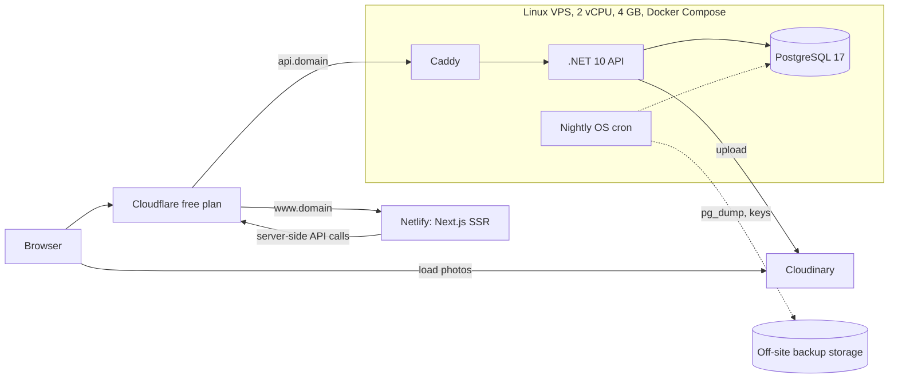

# Architecture (MVP)

One small Linux VPS runs the .NET 10 API and PostgreSQL behind Cloudflare's free plan; Next.js runs on Netlify and photos live on Cloudinary's free plan. Estimated running cost is about US$6 to US$46 a month. Detail and rationale: [MVP technical design](../../BasaChai-Technical-Design-MVP.html).

Version 1.0 · 13 October 2026 · Covers D12 to D17, D21

## Stack

| Layer | Choice |
| --- | --- |
| Edge | Cloudflare free plan: DNS, TLS (Full strict), CDN, basic WAF |
| Web | Next.js App Router with SSR on Netlify (pages run as Netlify Functions), TypeScript, next-intl |
| API | ASP.NET Core on .NET 10 (LTS), EF Core with Npgsql, FluentValidation |
| Database | PostgreSQL 17 (`pg_trgm`, `ltree`, `unaccent`) |
| Reverse proxy | Caddy with a Cloudflare origin certificate |
| Photos | Cloudinary free plan via the `CloudinaryDotNet` SDK |
| Jobs | None (D12) |
| Rate limits | ASP.NET Core rate limiter, in memory |
| Tests | xUnit, NSubstitute or hand-written fakes, Testcontainers, Playwright |
| Banned | Moq, AutoMapper (D21) |

## Request flow



- The browser loads photos straight from Cloudinary's CDN; image traffic never reaches the VPS.
- PostgreSQL has no public port. The VPS firewall accepts HTTPS from Cloudflare IP ranges only.
- The cron is an operating-system task for backups, not an application job.

## Server layout

| Container | Memory cap | Notes |
| --- | --- | --- |
| `caddy` | 128 MB | Origin TLS; proxies everything to the API |
| `api` | 1 GB | `DOTNET_gcServer=0`; 12 MB request body limit (Kestrel and Caddy); Data Protection keys on a volume |
| `postgres` | 1.5 GB | `shared_buffers=768MB`, `effective_cache_size=2GB`, `work_mem=8MB`, `max_connections=40` |
| OS and cache | about 1.4 GB | Plus a 4 GB swap file |

Docker log rotation: 10 MB, 5 files per container.

## Code structure

```
basachai/
  src/
    BasaChai.Domain/          entities, enums, state machine, EffectiveStatus
    BasaChai.Application/     use cases, validators, DTOs, explicit mappers
    BasaChai.Infrastructure/  EF Core + migrations, Cloudinary photo store
    BasaChai.Api/             endpoints, auth, CORS, rate limits, ProblemDetails
  tests/
    BasaChai.Domain.Tests/
    BasaChai.Application.Tests/
    BasaChai.Api.Tests/
  web/                        Next.js app (Netlify)
  deploy/                     docker-compose.yml, Caddyfile, API Dockerfile, release, backup and restore scripts, checks
```

- Photo storage sits behind `IPhotoStore`; moving off Cloudinary changes one class.
- Mapping uses explicit `ToDto()` and `ToEntity()` extension methods.

## Environments

| Environment | Where | Purpose |
| --- | --- | --- |
| Local | Developer machine, same Docker Compose file | Day-to-day development; no VPS needed (Q1 deferred) |
| Staging | Separate Compose project on the VPS, smaller limits; Netlify preview deploy | Pre-release checks; stopped between releases |
| Production | VPS and Netlify production | Pilot |

Cloudinary uses a separate folder per environment (`basachai/{env}/...`).

## Cost estimate (monthly, US dollars)

| Item | Low | High |
| --- | --- | --- |
| VPS, 2 vCPU / 4 GB | 5 | 25 |
| Netlify | 0 | 20 |
| Cloudflare | 0 | 0 |
| Cloudinary free plan | 0 | 0 |
| Off-site backups | under 1 | 1 |
| Domain | about 1 | about 1 |
| **Total** | **about 6** | **about 46** |

Approximate; check provider prices before choosing (Q1, Q2, Q3).

## Related

[data model](data-model.md) · [API](api.md) · [photos](photos.md) · [security and operations](security-and-operations.md) · [roadmap](../roadmap.md)
